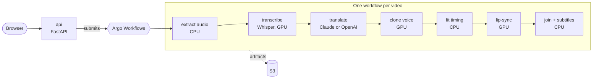

# Scope

Fukikae (吹き替え, "dubbing") turns a video of you speaking one language into a video of you speaking another, in
your own voice, with your lips matching the new words. It is part 4 of AI on EKS: multi-step GPU pipelines with Argo
Workflows.

- **It is** a dubbing pipeline for short talking-head videos (one speaker, up to 60 seconds in v1), built from
  open-source models on your own GPUs plus an LLM for translation.
- **It is not** a tool for making anyone say anything. It clones only the voice of the person who recorded the
  consent phrase, and labels every output.

## Why media

Creators, teachers and companies want their videos in more languages, and studio dubbing is slow and expensive.
Hearing yourself speak a language you don't know is also one of the most striking demos in AI. The work itself
(seven steps, mixed CPU and GPU, minutes per video) is exactly what Kubernetes batch tools are for.

## The product

| Actor | Does |
|---|---|
| Speaker | Records consent, uploads a video, picks a language, downloads the result |
| Viewer | Watches the dubbed video with subtitles |

1. **Consent:** the speaker reads a short phrase with a one-time code shown on screen. Speech-to-text must match the
   phrase and the code, and the voice must match the voice in the uploaded video.
2. **Upload:** a talking-head video, one speaker, up to 60 seconds.
3. **Pipeline,** one Argo Workflow per video:
   1. Extract the audio (ffmpeg, CPU)
   2. Transcribe with word timings (Whisper, GPU)
   3. Translate each segment so it fits the original timing (Claude or OpenAI)
   4. Speak the translation in the speaker's voice (voice-cloning TTS, GPU)
   5. Fit the new audio to the original timing (CPU)
   6. Lip-sync the video to the new audio (GPU)
   7. Join video, audio and subtitles, and add the "AI-dubbed" label (ffmpeg, CPU)
4. **Progress:** the page shows each step as it runs; the Argo Workflows UI shows the same.
5. **Result:** the dubbed video, an SRT subtitle file, and the original side by side.

The target languages are the ones the chosen voice model speaks well; the ADR lists them.

**API (v1):** `POST /v1/consents`, `POST /v1/uploads`, `POST /v1/dubs`, `GET /v1/dubs/{id}`,
`GET /v1/dubs/{id}/events` (server-sent events).

## Rules

| # | Rule | Enforced by |
|---|---|---|
| R1 | Only your own voice. | Consent phrase with a one-time code; transcript match and speaker match against the video; the consent recording is kept with the output |
| R2 | Every output is labelled AI-dubbed. | A visible label in the video, and in the file's metadata |
| R3 | One speaker, 60 seconds or less, in v1. | Checked on upload: duration, and speaker count from diarization |
| R4 | A failed step retries without redoing finished steps. | Argo retries per step; each step's output is saved to S3 as an artifact |
| R5 | Uploads and outputs are deleted after 7 days. | S3 lifecycle rule and clean-up of finished workflows |

## Architecture (target)

## What it teaches on Kubernetes

New in part 4:

- Argo Workflows: a WorkflowTemplate with one container per step, per-step retries and resources, artifacts in S3
- Karpenter with separate CPU and GPU NodePools, so each step lands on the right kind of node
- NVIDIA time-slicing so several steps share one GPU, measured against one step per GPU
- RBAC: the API's service account can create Workflows from one template and nothing else
- Clean-up: time limits on finished workflows, and archived history

Reused from earlier parts: Karpenter GPU NodePools and Spot, Pod Identity, Argo CD, External Secrets.

## Models and licenses

| Task | Model | Runs on | License note |
|---|---|---|---|
| Speech to text | Whisper (or faster-whisper) | GPU | MIT |
| Translation | Claude or OpenAI | API | |
| Voice cloning | Open-source voice-cloning TTS (candidates: F5-TTS, CosyVoice) | GPU | Check carefully: some weights are non-commercial, and language support differs |
| Lip-sync | Open-source lip-sync model (candidates: LatentSync, MuseTalk) | GPU | Check carefully, per model |
| Speaker match | Open-source speaker-embedding model | GPU or CPU | Chosen in an ADR |

The ADRs compare the candidates on quality, languages, GPU memory, speed and license, on one 24 GB GPU.

## Results to publish

| Number | How it is measured |
|---|---|
| GPU minutes per minute of video | Per step and in total |
| Cost per dubbed minute | Per language |
| Time-slicing vs one step per GPU | Throughput and cost |
| Time lost when a GPU node dies mid-pipeline | Drill: steps re-run and minutes lost |
| Quality | A back-translation score and a lip-sync score for each output |

## Out of scope (v1)

More than one speaker, videos over 60 seconds, live dubbing, voices of people who did not consent.
